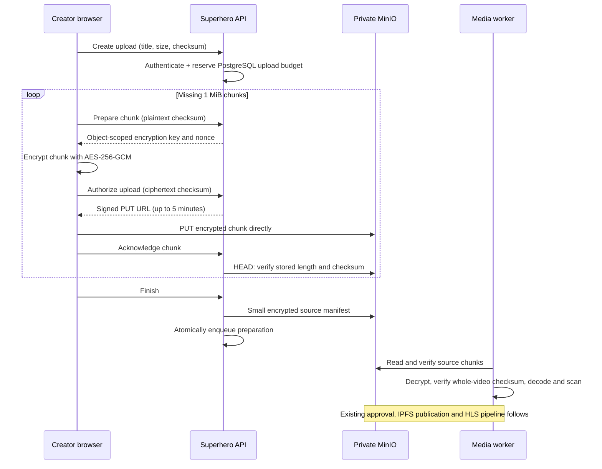

# Direct creator uploads

The browser sends video chunks directly to the private MinIO/S3 bucket. The API
authorizes the creator, reserves capacity, signs temporary upload URLs, checks
object metadata and queues preparation. It does not receive video upload bodies.



## Configure

1. Keep the existing bucket private, with no anonymous read, write or listing.
   Use scoped API credentials for `PutObject` and `GetObject`/`HeadObject` within
   the configured prefix. Keep worker credentials separate. No credentials are
   placed in the website environment.
2. Expose the MinIO **S3 API**, using a trusted HTTPS certificate, on an upload
   origin such as `https://uploads.example.com`. Keep its administration console
   private. Preserve the original Host, path, query and signed headers at the
   reverse proxy; do not rewrite the bucket path. Avoid buffering request bodies
   in the proxy. Apply ingress rate/concurrency limits and a maximum object body
   of 1 MiB + 36 bytes to browser PUT traffic. Do not apply this small cap to
   internal worker output writes, which can be larger.
3. Set `SHORTS_PRIVATE_S3_UPLOAD_ENDPOINT=https://uploads.example.com` on the API.
   This must reach the **same bucket** as `SHORTS_PRIVATE_S3_ENDPOINT`, which can
   remain an internal endpoint. Region and path-style settings must agree. Only
   the API needs the public signing origin; workers keep their private endpoint.
4. Allow the website's exact origin in the bucket/provider CORS configuration.
   Allow `PUT`, and request headers `Content-Type`, `Cache-Control`,
   `If-None-Match`, `x-amz-checksum-sha256`. Allow normal preflight `OPTIONS`
   through the proxy. Browser requests use no cookies or Studio bearer token.
   CORS is browser policy, **not** authorization; the signed request remains
   mandatory. Example AWS-compatible bucket CORS configuration:

   ```json
   {"CORSRules":[{"AllowedOrigins":["https://superhero.stream"],"AllowedMethods":["PUT"],"AllowedHeaders":["content-type","cache-control","if-none-match","x-amz-checksum-sha256"],"MaxAgeSeconds":300}]}
   ```

   Apply the provider's equivalent configuration if the installed MinIO release
   uses server-wide CORS settings. Do not make the bucket public to fix CORS.
5. Set `SHORTS_UPLOAD_ORIGIN` to the same public origin on the web Express server,
   so its CSP permits the browser connection. For other hosting systems, add that
   exact origin to `connect-src` in their CSP.

## Deploy in order

Apply migration `1792022400000-ShortsDirectUploads`. It adds bounded per-part
permission records to upload sessions and preserves all existing records.
Deploy updated media workers **before** enabling the new API and web client:
workers must support the `SHPRIV02` envelope. Old encrypted objects still use
`SHPRIV01` and remain readable. Keep old encryption keys until their objects are
retired under the agreed retention policy.

Deploy API and web together. Hosted upload status advertises
`transport: "direct-s3-v1"`; the local loopback demo keeps its existing transport.
Hosted `POST /upload` and `POST /uploads/:id/parts/:index` reject before parsing
binary bodies. Old browser tabs must refresh. There is no proxy fallback on a
storage outage. Resuming an older upload skips its already accepted chunks and
sends missing chunks directly to storage.

## Verification and boundaries

- Check browser network traffic: file bodies go to the storage origin; API calls
  carry only JSON metadata. Finish may write a small encrypted JSON manifest.
- Each signed PUT fixes the key, exact encrypted length, SHA-256 checksum and
  `If-None-Match: *`. MinIO must enforce all of these and return the actual stored
  checksum on `HEAD` with `ChecksumMode: ENABLED`. Test against the installed
  version: wrong size/checksum must fail; an existing key must return 412.
- A permission is not a received chunk. The completion endpoint verifies storage
  metadata before recording it. A worker independently checks authentication tags,
  every plaintext hash and the whole-video hash before decoding or approval.
- First permission/checksum per part wins under a PostgreSQL lock. Retries reuse
  the key and nonce; a conflicting payload requires a new upload. Never log
  permission responses, derived keys or signed URL query strings.
- The browser receives a derived key for its own chunk only, never the server's
  master key. Encryption remains useful for private storage; it does not make
  the creator's own uploaded content inaccessible to that creator.
- Permissions expire within five minutes, or earlier at session expiry. Already
  issued URLs remain usable until expiry even after logout. They cannot read,
  list or overwrite objects. Invalid/abandoned objects consume the reserved
  budget; expiry does not refund it. Inventory includes issued object references.
  Automatic deletion remains disabled.
- This change removes the **upload** data path from the API. Existing private
  preview and rescan paths are separate media operations; they are not a claim
  that the entire API has no media reads. Public playback remains on streaming.

Run `npm run test:shorts:direct-uploads` for signing, envelope and completion
checks, and `npm run test:shorts:uploads` with `SHORTS_TEST_PG_URL` pointing to an
isolated loopback database for concurrent reservation tests. Test a browser upload
against the configured MinIO origin before enabling traffic.
