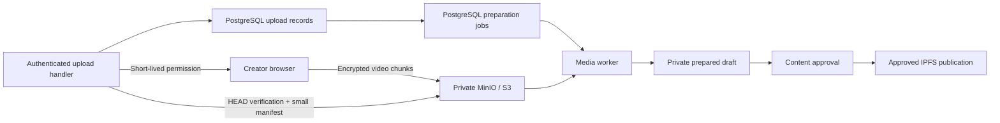

# Private upload storage

Unreviewed video parts and source manifests belong in a **private S3-compatible
bucket**. Approved playback still uses IPFS. S3 credentials and
master encryption keys stay on the server. Browser uploads use short-lived, write-only
permissions and object-scoped encryption keys; the bucket remains private. See
[direct upload setup](DIRECT-UPLOADS.md) for the HTTPS endpoint, CORS and rollout steps.

## Module and runtime

`ShortsSharedUploadsModule` provides the PostgreSQL upload repository and private
source coordinator. It depends on the application's TypeORM connection and
`ShortsPrivateObjectsModule`, with no chain signer or video decoder dependency.
Apply normal API migrations before using it.

Hosted `ShortsTestnetModule.register(true)` uses this module for new uploads and
requires its S3 configuration. The loopback-only demo retains its local adapter.
The hosted API accepts jobs; `npm run start:shorts:worker` runs the separate Nest
media worker. It has no HTTP listener, contract signer or IPFS write key.

Existing prepared records must move to shared object references before hosted
startup. Use the [offline migration](LEGACY-STORAGE.md) for content, private media,
saved uploads, analytics and receipts. The API checks its shared completion record
and rejects missing private references. It never creates or reads local quarantine
files. Keep source backups and keys until restore and retention requirements permit
removal. Signing belongs only to the separate publisher. Retain the single-instance
deployment limit until distributed ingress limits and capacity tests permit scaling.

The shared module's flow is:



Parts use immutable keys containing the deployment scope, upload ID and content
hash. A part's first accepted bytes cannot be replaced. Finish freezes the part
list, writes an encrypted manifest, then atomically accepts the job in PostgreSQL.
A worker verifies every part and the whole-video checksum before decoding. Storage
IO runs outside database transactions. Retrying after a lost response reuses the
accepted input. A crash before recording an object can leave an unreferenced object;
it cannot create a falsely completed upload.

The worker computes package CIDs locally with pinned UnixFS parameters, verified
against Kubo, then writes encrypted outputs under its lease fence. Only the current
claim may attach those outputs to a draft. Workers never approve content, pin it or
sign a publication. The API's durable lifecycle job verifies the accepted output
references and CID again before pinning approved content to IPFS. The separate
publisher signs the on-chain registration. Creator previews and rescans read the
same private objects. Upload permissions expose only the selected part’s upload path
and derived encryption key, never a bucket credential or the encryption key ring.

## Running the worker

1. Apply API migrations and configure private S3 on the hosted API. Start the API
   first so it initializes the verified network/contract namespace in PostgreSQL.
2. Create a separate worker environment from `worker.env.example`. Use the same
   database, public deployment manifest, bucket/prefix and encryption key ring.
   Give the worker its own revocable S3 and database credentials and moderation
   credential. Do not copy the API's environment or mount its data volume.
3. Run `npm run build`, then `npm run start:shorts:worker`. For containers, use
   `compose.shorts-worker.yaml` with the API release image pinned by digest and
   explicit paths to the worker environment and secret files. It has a read-only
   filesystem, temporary scratch space, CPU/memory/PID limits and no published port.
   Bind-mounted secret files must be owner-only and readable by UID 1000.
4. Check authenticated `/api/shorts/operator/ingestion`: it reports shared queue
   counts, oldest queued age and workers seen within 30 seconds. Test a real upload
   and readiness before routing staging traffic to the new release.

Each worker prepares one video at a time. PostgreSQL also limits concurrent
processing across all workers for the same network/contract (default **two**).
Extra workers remain idle until capacity is available; they do not increase this
limit. A refused claim consumes no attempt and is retried on the normal poll.

Workers renew their database lease and cancel IO/FFmpeg on shutdown, refusal or a
conservative local lease deadline. The deadline starts before the database call,
so a delayed response cannot extend work merely by arriving late. A stuck
heartbeat does not suppress cancellation. A crash leaves the job recoverable by
another worker after lease expiry. Lease uncertainty keeps accepted work pending
for recovery; it does not classify the video as invalid. Attempts are capped at three. Encrypted output
keys include the fence, so stale work cannot overwrite accepted output. The HTTP
API caps queued/processing jobs at eight, two per creator. The shared
[retained upload budget](UPLOAD-BUDGET.md) bounds accepted upload count and source
bytes independently. Its defaults are 50 retained uploads and 50 × 40 MiB; explicit
setup can change them after capacity planning. Retries reuse their reservation
even when new ingress is paused. These are safeguards, not measured public-launch capacity.

The worker uses the same complete versioned manifest as the API; see
[release identity](README.md#contract-release-identity). Reduced receipts are not
accepted. It validates the manifest through the shared bounded loader, checks its
scope and source hash against the API's initialized database identity, and
rejects mainnet, demo approval bypasses and signing/IPFS/streaming credential paths.
Its decoder child receives a minimal environment. Container isolation must also
prevent access to unrelated secrets and services; enforce egress rules for the
configured PostgreSQL, S3, moderation and optional classification endpoints.
Use a dedicated database login with **no application-table privileges**. The worker
accesses application data only through `shorts_media_worker(text,jsonb)` and reads
system catalogs to verify the capacity guard at startup. PostgreSQL checks its enrolled login,
deployment, source hash and lease owner on each call. Completion constructs an
unapproved draft from accepted upload metadata; it cannot update existing content,
approve it, set publication state or change counters. Do not grant the worker the
API or migration role. See database enrollment below.

## Shared processing capacity

Processing capacity is enforced by migration `1791763215000` at the ingestion
row transition, including calls made through the restricted worker function. The
worker refuses startup when this trigger is absent or disabled. Use PostgreSQL's
normal READ COMMITTED isolation for claims and renewals. Contention returns no
claim promptly rather than queuing database lock waits.

Drain workers before deploying the migration and updated worker image together.
Existing uploads and results are preserved. Stop workers before rolling back the
capacity migration: rollback removes this protection. Only the trusted database
operator may change capacity; worker credentials cannot edit it. After measuring
CPU, memory, temporary disk, moderation and S3 throughput, update one deployment:

```sql
UPDATE public.shorts_runtime
SET max_processing = 2
WHERE network = 'ae_uat' AND contract = '<deployed contract address>';
```

Values must be 1–32. Lowering the value lets current valid leases drain and holds
new claims until there is space; it does not forcibly cancel a creator's active
preparation. Renewal does not consume another slot, and an expired lease cannot
be revived. Increasing it does not provision more machines or prove capacity.

These are logical job limits. Keep container CPU/memory/PID/tmpfs limits and
measured host placement: a paused or unhealthy host can delay cancellation of a
child process. Database fencing still prevents stale work from attaching output.
The HTTP upload-body limit remains per API process; shared request/byte budgets
are documented in [RATE-LIMITS.md](RATE-LIMITS.md). Do not multiply API instances
based solely on this worker limit.

## Scratch space and capacity waits

`compose.shorts-worker.yaml` limits Docker stdout/stderr logs to three 10 MB files
per container. Recreate the container to apply logging changes; a restart preserves
its old settings. Forward any logs needed beyond rotation to your controlled log
store. Budget these files alongside scratch, image layers, stopped containers,
database/WAL and backups. Scratch admission does not reserve space for these other
writers. Keep independent host byte/inode alerts and quotas; do not use unapproved
media or backup deletion as a capacity remedy.

The decoder uses an instance-owned directory (`SHORTS_WORKER_TMP_DIR`). The
Compose worker supplies a 512 MiB tmpfs; do not share it between worker processes.
The same injectable encoder protects the local development upload path. Hosted
API requests still never decode videos.

Before claiming a job, the worker checks available bytes and inodes. Encoding
reserves 192 MiB plus allocation slack and 16 inodes until its own temporary files
are removed. These reservations are conservative: already-written bytes remain
reserved until cleanup. Configure the following in the dedicated worker env file:

| Variable | Default | Purpose |
| --- | --- | --- |
| `SHORTS_WORKER_MIN_FREE_BYTES` | `67108864` | Keep at least 64 MiB free |
| `SHORTS_WORKER_MIN_FREE_INODES` | `128` | Keep at least 128 inodes free |
| `SHORTS_WORKER_MAX_USED_PERCENT` | `85` | Also keep 15% of both byte and inode capacity free |

Admission uses the stricter absolute or percentage floor, including reservations.
Unknown filesystem statistics pause work. A filesystem probe has a one-second
deadline and only one probe can remain outstanding. While encoding, a 250 ms
monitor cancels the decoder if actual space falls below a floor; cleanup runs
before releasing the reservation. This sampled check is not a hard quota. Keep
container limits, host monitoring and placement controls; filesystem statistics
may not expose project quotas or changes from other processes between samples.

Apply migration `1791763222000` before starting the new worker image. Startup
requires its capacity-deferral capability. Pressure before a claim leaves attempts
untouched. Pressure during encoding returns the current valid claim to the queue
with a five-second delay and refunds only that claim's attempt. The database
retains its fence; another principal, expired claim or replay cannot refund it
again. Earlier genuine failures remain counted. Logs announce capacity loss and
recovery; monitor queued age and the scratch volume to diagnose a prolonged wait.
No source objects, content or pins are deleted by this mechanism.

Drain processing and capacity-deferred jobs before rolling back this migration;
rollback refuses while either remains. Restoring space lets deferred jobs resume.
Do not clear accepted jobs to force a rollback.

## Scanner availability

Before claiming an upload or reading its private source, the hosted worker checks
the moderation service's bounded `/health` endpoint. `ready: true` means the
scanner is healthy; `accepting: false` means it is busy. Older scanner versions
omit `accepting`, so an inspection may still receive backpressure after admission.

Inspections run before encoding. HTTP 408/429/5xx, transport failures and inspection
deadlines return the current live claim to the same fenced capacity queue, using
migration `1791763222000`. No new migration or queue is required. The durable
five-second cooldown survives worker replacement; each worker also backs off
between 5 and 60 seconds, with jitter, while availability checks fail. These waits
do not consume the video's processing retries or delete its encrypted S3 source.
Lease expiry and shutdown remain lease-recovery events, not refunded attempts.

Invalid media, missing credentials, authentication failures and malformed or
incomplete evidence still produce a private error draft for repair; they are not
classified as temporary capacity failures. Successful scans retain the normal
publication policy and never approve a video by themselves. Monitor queue age,
moderation readiness and failure logs; an ongoing outage pauses preparation and
requires operator attention. There is no implied maximum queue-retention period.

## Worker database enrollment

Apply migration `1791763204000` with the normal trusted migration identity. The
function has a fixed search path, qualified application relations and no PUBLIC
execute grant. Its owner must remain a trusted migration identity, never the media
worker. This follows PostgreSQL's [security-definer guidance](https://www.postgresql.org/docs/16/sql-createfunction.html#SQL-CREATEFUNCTION-SECURITY).

A DBA then creates a dedicated login and enrolls it for the API's initialized
testnet deployment. Substitute the database, schema and contract below. Set its
password through your secret manager or the interactive `psql` `\password` command;
do not put the password in a SQL file or shell history.

```sql
CREATE ROLE shorts_media_worker LOGIN NOSUPERUSER NOCREATEDB NOCREATEROLE
  NOINHERIT NOREPLICATION NOBYPASSRLS CONNECTION LIMIT 8;
GRANT CONNECT ON DATABASE superhero TO shorts_media_worker;

BEGIN;
GRANT USAGE ON SCHEMA public TO shorts_media_worker;
GRANT EXECUTE ON FUNCTION public.shorts_media_worker(text,jsonb)
  TO shorts_media_worker;
INSERT INTO public.shorts_worker_principals(role_oid,role_name,network,contract)
  SELECT oid,rolname,'ae_uat','ct_REPLACE_WITH_DEPLOYMENT'
  FROM pg_roles WHERE rolname='shorts_media_worker';
COMMIT;
```

Use this login in the dedicated worker environment. Startup refuses superusers,
role memberships, creation privileges, application-table access and access to
other application security-definer functions. Inherited PUBLIC grants count too.
If it fails, have the DBA correct excessive grants; do not relax the check or use
the API login. Refusing startup does not revoke an accidental grant: the DBA must
remove it. On older databases, PUBLIC may have schema creation rights that need
review before removing them. The worker can use temporary scratch relations, but
they cannot shadow the qualified relations inside the function.

Each login is bound by both PostgreSQL role OID and name to one deployment. Use
separate logins when independent revocation is needed. To revoke an identity:

```sql
UPDATE public.shorts_worker_principals SET enabled=false
  WHERE role_name='shorts_media_worker';
```

Later worker calls are denied, including heartbeats and completion; another worker
can recover its jobs after their leases expire. An already executing transaction
may finish. For an urgent incident, also revoke function execution, terminate that
login's existing sessions, stop its container and rotate its S3/moderation secrets.
Recreating a dropped role requires explicit re-enrollment; matching its old name
alone is insufficient. Stop workers before rolling back this migration. Rolling it
back preserves content but removes its function, grants and enrollment; reapplying
requires granting and enrolling worker logins again. These grants do not sandbox
a compromised worker's S3 access, prevent every database resource-exhaustion attack or validate video safety.
Keep connection/resource limits, egress restrictions and content approval separate.

## Configuration

| Variable | Value |
|---|---|
| `SHORTS_PRIVATE_S3_ENDPOINT` | HTTPS S3 origin, without a bucket, path or credentials |
| `SHORTS_PRIVATE_S3_REGION` | Provider's signing region, such as `us-east-1` |
| `SHORTS_PRIVATE_S3_BUCKET` | Existing private bucket |
| `SHORTS_PRIVATE_S3_PREFIX` | Object prefix; default `shorts-private-v1` |
| `SHORTS_PRIVATE_S3_PATH_STYLE` | `true` by default; use `false` if required by the provider |
| `SHORTS_PRIVATE_S3_CREDENTIALS_FILE` | Absolute path to an owner-only JSON credential file |
| `SHORTS_PRIVATE_ENCRYPTION_KEYS_FILE` | Absolute path to an owner-only JSON encryption key ring |
| `SHORTS_PRIVATE_S3_ALLOW_LOOPBACK` | `1` permits loopback HTTP for local tests only; rejected in production |

Mount both secret files with mode `0600`, readable by the process user. Credential
JSON has `accessKeyId`, `secretAccessKey`, and optional `sessionToken`. No ambient
AWS credential chain is used. The encryption file has `activeKeyId` and a `keys`
object mapping key IDs to independently generated 64-character lowercase hex keys
(32 random bytes each). Never put real secrets in an environment example or Git.
Up to eight keys may be retained. Configuration is loaded when the module starts.

AES-256-GCM authenticates each object and binds its key, key ID, length and hash.
New writes use the active key; reads retain support for older keys. Back up keys
separately from the bucket. Do not remove a key while any retained object uses it.
Rotation requires mounting the new ring and restarting users of that ring; it does
not rewrite old objects. Credential rotation likewise requires a restart.

## Provider requirements

DevOps supplies the endpoint, region, bucket, addressing mode and mounted credential
paths. The bucket must deny anonymous access, disable public ACLs/policies, and
use TLS. Allow each API/worker identity only the required prefix and object read /
conditional-write operations (`s3:GetObject`, `s3:PutObject`). Do not grant bucket
administration, object deletion or listing to these identities. Use separate
identities for independently revocable services. Encryption keys also remain
separate from IPFS, moderation, streaming and chain-signing credentials.

The provider must enforce `PutObject` with `If-None-Match: *`, support SHA-256
checksums and provide immediate reads after a successful write. Verify these
properties and anonymous-access denial against the chosen provider. The adapter
does not create buckets or change bucket policy. An emulator is not evidence that
real bucket permissions are correct. See [S3 conditional writes](https://docs.aws.amazon.com/AmazonS3/latest/userguide/conditional-writes.html).

Do not configure blanket expiry on this prefix: originals may still be needed by
active jobs, rescans or legal holds. Referenced-object retention and orphan cleanup
must be coordinated with database records by a separate privileged lifecycle owner.
Back up and restore the database, objects and encryption key ring together.

The separate [storage inventory command](STORAGE-INVENTORY.md) uses a dedicated
listing-only identity to record object versions and delete markers in PostgreSQL.
It does not need encryption keys or grant listing/deletion rights to API or worker
identities. Inventory completion alone does not establish safe cleanup.

The separate [reference reconciliation command](STORAGE-REFERENCES.md) uses a
read-only S3 identity and the encryption ring to expand source manifests and match
references/holds with those observations. It never reads complete source videos
or changes storage. API and worker credentials do not gain these operations roles.

## Local checks

`npm run test:shorts:objects` runs adapter security tests. `npm run
test:shorts:uploads` tests concurrent upload records with `SHORTS_TEST_PG_URL`
pointing to disposable loopback PostgreSQL. Set `SHORTS_TEST_S3_ENDPOINT`,
`SHORTS_TEST_S3_ACCESS_KEY` and `SHORTS_TEST_S3_SECRET_KEY` for the S3 integration
cases. Tests create temporary buckets and database schemas, then remove them; use
isolated test credentials with cleanup privileges, never runtime credentials.

`npm run test:shorts:authority` uses disposable PostgreSQL logins to exercise direct
SQL denial, forged completion, deployment/lease isolation, privilege drift and
revocation. Its isolated test administrator needs permission to create/drop roles.
`npm run test:shorts:worker` also uses a restricted login while testing actual media
preparation and process-kill recovery through the production Nest module.

`SHORTS_TEST_S3_EMULATOR=1` skips the explicit anonymous-access assertion for an
emulator without authorization enforcement. It does not disable any runtime check
and must not be used as proof of deployment security. PostgreSQL and S3 integration
cases report skips when their test endpoints are absent.

`npm run test:shorts:processing` checks shared processing admission with restricted
PostgreSQL workers, lease expiry, migration rollback/startup guards, stalled
heartbeats and shutdown. Set `SHORTS_TEST_PG_URL` to an isolated disposable
loopback database to include the database cases.

`npm run test:shorts:scratch` exercises filesystem admission, reservation races,
probe deadlines and cancellation/cleanup of a real FFmpeg process with generated
media. Processing tests also verify delayed claims and single refunds after a
lost deferral response. These tests do not validate host quotas or deployed IAM.
