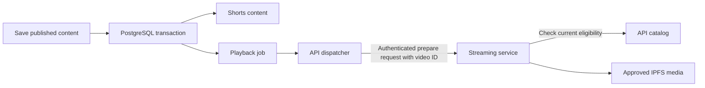

# Playback preparation

The hosted API keeps playback-preparation jobs in PostgreSQL. The streaming
service fetches approved media and prepares HLS; the API sends only the video ID.
Wallet credentials and video bytes never pass through this dispatch request.

## Configuration

Apply all API migrations, including `1791763206000-ShortsStreamingOutbox` and
`1791763214000-ShortsSharedCutover`, before starting the hosted API. Its database role needs SELECT, INSERT, UPDATE and DELETE on
`shorts_stream_jobs`, in addition to its existing content/runtime permissions.
Publication also writes this table through a security-invoker trigger, so a trusted
content-import or repair identity needs the corresponding outbox permissions.
The restricted media-worker login continues to use only its existing function;
do not give it direct table grants.

- `SHORTS_STREAM_INTERNAL_URL`: private streaming-service origin. HTTPS is
  required outside loopback development; do not use the public edge/cache URL.
- `SHORTS_STREAM_KEY_FILE`: absolute path to the server-only 64-character hex
  bearer key shared with the preparation endpoint. Mount it as an owner-only file.
- `SHORTS_STREAM_URL`: public playback URL used by lifecycle tests; it is not a
  substitute for the private preparation origin.

An unset preparation endpoint leaves jobs pending without sending requests.
Hosted startup still verifies the deployment identity and shared table. The
loopback-only local demo uses its existing SQLite outbox.

## Delivery and recovery

Saving publication and scheduling its job commit together. The migration seeds
existing published content, and later imports/recovery use the same trigger.
Playback-affecting changes invalidate an earlier delivery claim; unrelated title,
view or report updates do not restart preparation. Withdrawal removes its job.
The dispatcher and streaming catalog independently check current content policy;
a queued job is never an approval or permission to serve media.

Dispatchers claim one due job at a time using a 30-second database lease and
`SKIP LOCKED`. Each pass handles at most 20 jobs. Each attempt has a 30-second work
deadline covering claim acquisition, credential loading, both eligibility reads
and HTTP; it never starts new work after local lease expiry. HTTP requests also
time out after 10 seconds. A 202 response schedules another check after 15 seconds; 200 records
preparation as ready. Failures retry with exponential delay capped at five minutes.
Database outages leave work pending. Shutdown aborts active requests; abandoned
claims are recoverable after lease expiry. An expired attempt cannot acknowledge a
late response as ready. Started SQL drains under its separate database deadlines;
the work deadline is not an instantaneous process-exit guarantee.

Completion requires the current generation, token and unexpired database lease,
checked after acquiring the row lock. A stale dispatcher cannot mark newer work
ready or delete it. Delivery is **at least once**: if a process dies after the
streaming service accepts its request, another dispatcher may repeat it. The
streaming endpoint must keep prepare-by-ID idempotent. “Ready” records preparation
acknowledgement, not a permanent guarantee of remote storage health.

Take this table in the same database backup as content. Stop hosted dispatchers
before schema rollback. Rollback removes jobs but preserves content; reapplying
rebuilds pending jobs from published content and can repeat prepare requests.
Do not run an older API with a stale local snapshot after shared operation begins.
The hosted API no longer reads local private files or signs publications. Retain
its single-instance deployment limit until distributed ingress limits and measured
capacity permit scaling. Shared outboxes alone do not close those requirements.

`npm run test:shorts:stream-jobs` requires a disposable loopback PostgreSQL database
in `SHORTS_TEST_PG_URL`. It tests independent connections, transaction rollback,
policy changes during IO, expired leases, actual dispatcher process termination,
shutdown, and schema rollback/reapply. It does not call a deployed streaming
service or certify end-to-end HLS availability.
